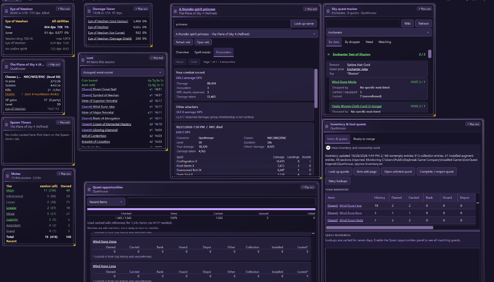
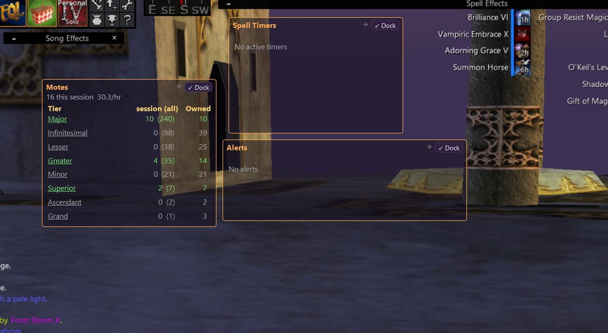
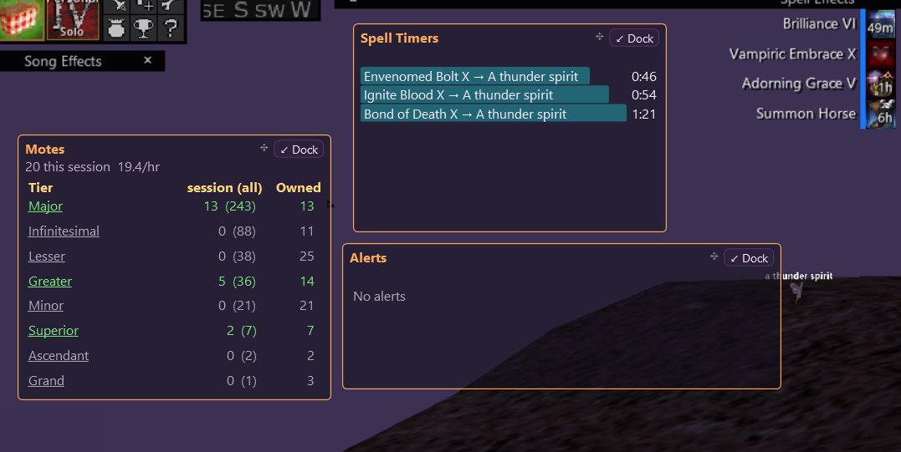

# EqLog Overlay

An app for Windows that reads EverQuest Legends log files (`eqlog_*.txt`) and shows live stats in
small borderless, always-on-top overlay windows over the game.

Track damage, healing, loot, spell and spawn timers, quest ingredients, chat, and custom alerts.
Use floating overlays over the game or arrange panels in the main window on another monitor.

## Screenshots

### Dashboard preview



An example Plane of Sky dashboard with the settings panel hidden. Each tile can be moved,
resized, or detached with **Pop out**. **Auto-arrange** is off by default, so you can keep a
custom layout like this without other panels shifting around.

Highlights from the screenshot:

- **Combat and session stats:** DPS and damage share, incoming damage by attacker/spell,
  character loadout and level, zone/session time, kills, deaths, and XP gains.
- **Loot and [Motes](#motes):** grouped recent drops, coin looted and auto-sold totals,
  clickable **[Quest]** markers, and per-tier session, all-time, and owned mote counts.
- **[NPC compendium](#npc-compendium):** search by name and zone, then browse **Overview**,
  **Spell resists**, or **Encounters**. Encounter cards show your average DPS, other attackers'
  damage, incoming damage, and a per-spell breakdown for each recorded fight.
- **[Sky quest tracker](#plane-of-sky-class-quests):** class-filtered quests with rewards,
  quest givers, required dialogue, HAVE/NEED item counts, drop sources, and a watched-quest list.
- **[Inventory & loot quests](#inventory--loot-quests-overlay):** compare owned, carried,
  bank, hoard, and depot counts; open item/quest wiki pages; mark quests complete or reopen them;
  and find upgrade-rank duplicates in **Ready to merge**.
- **[Quest opportunities](#loot-quest-lookup):** sort or search items and quest references,
  watch lookup progress and cache/queue totals, and compare inventory locations with historical
  loot. Historical loot is unconfirmed, not proof that you still own an item.
- **[Spawn timers](#spawn-timers):** countdowns for mobs you choose to track in the current
  zone. The screenshot shows the empty state before any mobs are selected.

### Floating overlay example



Floating overlays can be positioned and resized over the game while unlocked; their gold borders
and **Dock** buttons are visible in this example. Lock them to pass clicks through to the game.
See [Overlays](#overlays) for the available panels and controls.

**Alerts:** Make important log events easier to notice with regex triggers that display a custom
message in the Alerts panel and can optionally play a sound. [Set up alert triggers](#alert-triggers).

### Spell countdowns



Each active timer shows the spell, its target, and the time remaining. Here, three spells on
**A thunder spirit** have **0:46**, **0:54**, and **1:21** remaining. These are estimated countdowns;
see [Spell durations](#spell-durations) for how durations are learned and adjusted.

## Installation

1. Download **EqLogOverlay-win-Setup.exe** from the [latest stable release](https://github.com/AnQueth/eql/releases/latest).
2. Close any running copy of the app, then run the installer.
3. Launch **EverQuest Log Overlay**.

The Windows x64 release includes .NET; you do not need to install a separate runtime.
Installers are currently unsigned, so Windows may display a SmartScreen warning. Only install
files from a source you trust.

For a portable copy, download **EqLogOverlay-win-Portable.zip**, extract the entire archive,
and launch **EverQuest Log Overlay.exe**. Keep the launcher, `Update.exe`, and `current` directory
together; do not copy just the executable.

## First-time setup

1. Turn logging on in EverQuest with **`/log on`**.
2. Use **windowed or borderless** mode; overlays cannot draw over exclusive fullscreen.
3. The app looks for logs in the usual EverQuest Legends and EverQuest Live install folders. If none are found,
   it asks you to choose your **Logs** folder (choosing the EverQuest install folder also works). You can change it
   later in **General > Log file** with **Choose folder...**, or pick a single file with **Browse...**.
   If the folder has no logs yet, type `/log on` in game and the log is picked up automatically.
4. Every panel starts **docked** in the main window (Alerts float over the game). In **General > Overlays**,
   enable the panels you want and untick **docked** to float one over the game.
5. Unlock floating overlays to arrange them, then lock them to pass clicks through to the game.

The default log folder is:

```text
C:\Users\Public\Daybreak Game Company\Installed Games\EverQuest Legends\Logs
```

On startup the app reads the selected file's history, then follows new lines live.
With **Follow newest log** checked, it switches to whichever `eqlog_*` file is written to next,
such as when you change characters. Startup history does not fire alert triggers.

If floating overlays are missing while arranging them, temporarily turn off
**Only show floating overlays while EverQuest is active**.

## Reset tracking data

Use **Settings > General > Tracking data > Reset tracking data...** to rebuild tracking from logs.
After confirmation, the app saves settings and closes. Open it again to complete the reset and
reprocess the selected log. NPC encounters, resistance observations, learned spell durations and
overrides, spawn timers and overrides, mote history, and tracked inventory are moved into
`%AppData%\EqLogOverlay\tracking-backups` before fresh tracking stores load.
Settings, alert triggers, layout, themes, original game logs, and lookup caches are preserved.
Only data present in available logs and inventory exports can be rebuilt; other log files must
be opened separately. A failed reset stops startup with an error instead of loading partial data;
the reset request remains for retry and already-backed-up files are not overwritten.

## Usage and error telemetry

Usage and error telemetry is off by default. Enable **Share usage and error telemetry** in
**General > Application updates** to send app-start, feature-use, and error events to Azure Application Insights.
Events include fixed feature/action labels, app version, bundled theme choices (or `Custom` for
imported/edited themes), Windows-following versus fixed theme mode, and each panel's enabled
state and docked/floating placement. Current theme and panel settings are reported at startup
and when telemetry is enabled; subsequent changes are reported separately. Floating means
configured as an in-game overlay, not proof it is currently visible over the game.
An anonymous random session ID groups events within one opted-in run; it changes on restart
or re-enabling telemetry and is not a persistent user/device identifier. Counts describe
opted-in sessions and actions, not unique people or time spent using features.
For errors, only the exception type and source are included. The app
does not send game or log contents, character or item names, custom theme names/colors,
file paths, exception messages, or
stack traces. Azure Monitor may still process standard service/network metadata. Turn off
**Share usage and error telemetry** in **General > Application updates** to prevent new events
from being collected.
Existing saved telemetry preferences are preserved.
Telemetry uses the configured Application Insights connection string; the
`APPLICATIONINSIGHTS_CONNECTION_STRING` environment variable overrides the built-in default.

### Legends class loadouts

Use **/who** so your own entry appears in the log, for example
`[50 DRU/WIZ/ENC] Quethrosar (Erudite)`. The app matches your character name exactly
(ignoring case), tracks the listed classes in their logged order and level, and updates them
when another entry for you appears. Other players' entries and anonymous entries do not change
your loadout. The character, detected class loadout, and level appear in the **app title bar**,
as well as the **Session** overlay and log status. The title bar retains the app version and
updates automatically when your own /who entry changes.

Learned normal spell damage is kept separate by **character, class loadout, level, and exact
spell rank**, so different Legends builds do not distort each other's reduced-damage estimates.
Use **/who after changing loadouts**: the app cannot detect an unlogged switch and uses the
last reported loadout until updated. After a login or changing character, classes are unknown
until your own /who entry is read; damage learning waits rather than guessing. Historical
/who entries are read in order on startup, reconstructing the last reported loadout.
Saved damage samples retain their loadout context across restarts. Earlier samples collected
before loadout tracking cannot be assigned to a class build retroactively.

## Appearance and themes

Settings tabs sit at the top of the side panel, with no global settings stacked above them.
**General** contains log, overlay, and chat settings; each tool uses the remaining panel height.
**Appearance** contains theme selection, JSON import, and the theme editor.

The **Appearance** tab edits a draft of your selected palette. Give it a name, enter `#RRGGBB`
colors or use **Pick...** beside each hex field to open the Windows color picker next to that button.
The picker switches sides or shifts upward near screen edges to stay in the monitor's work area.
Picking a color updates its hex field, swatch and preview; cancelling leaves the draft unchanged.
The preview is a small mock of the real app that uses every theme color: tabs, a search box with
selected text, a spell table with header, alternating, selected and hovered rows, a scrollbar,
normal / hovered / pressed buttons and a checked box, plus Spawn Timers and Experience overlays
over a game backdrop showing heading, dim, good, warning and bad rows. Hover any part to see which
colors it uses.
**Apply & save** activates the draft and
persists it across restarts. **Export JSON...** writes an importable theme file without changing
the active theme. **Reset draft** discards edits and reloads the last selected/applied palette;
choosing a different theme also replaces the draft. Invalid colors are reported and block apply/export.

New installs default to **Follow Windows light/dark mode**, using **Neutral Light** or **Neutral Dark**:
simple gray surfaces, readable text, and restrained blue accents. Neutral Dark uses deeper,
VS Code-style charcoal surfaces and subtle borders. Changes to Windows **app mode**
apply while the app is running. Both palettes provide at least 4.5:1 text contrast on their opaque
surfaces; overlay transparency and the game behind it can reduce actual contrast.
Existing saved theme choices are preserved. Uncheck **Follow Windows light/dark mode** to keep a
fixed palette; check it again to resume automatic switching. Applying an edited draft or importing
a palette also selects a fixed theme.

Use **Settings → Appearance → Theme** to switch between **Neutral Light**, **Neutral Dark**, **Halloween**, **Midnight Ocean**,
**Enchanted Forest**, **Crimson Ember** (warm red), **Royal Amethyst** (purple),
**Arctic Frost** (light blue), and **Desert Sand** (light sand), or choose **Import JSON...** for a
custom palette.

Accessibility themes:

| Theme | For | Overlay status colors |
|-------|-----|------------------------|
| **High Contrast Dark** | Low vision / glare; white on black, yellow accent | green / gold / light red, all ≥7:1 contrast |
| **High Contrast Light** | Low vision, bright rooms; black on white, dark blue accent | dark green / brown / dark red, all ≥7:1 contrast |
| **Colorblind Safe (Red-Green)** | Deuteranopia / protanopia | good = sky blue, warning = yellow, bad = orange |
| **Colorblind Safe (Blue-Yellow)** | Tritanopia | good = cyan, warning = white, bad = red |

All text in these themes meets WCAG contrast (7:1 for high contrast, 4.5:1 for colorblind themes).
Changes apply immediately
and the complete selected palette is saved in `%AppData%\EqLogOverlay\settings.json`; the original
import file is not needed on subsequent starts. Importing another file with the same name is allowed.
Invalid JSON, missing colors, and invalid color values are reported without replacing your theme.

Themes can also set the overlay text colors: section headings (`OverlayHeader`), secondary rows
(`OverlayDim`), and good / warning / bad status (`OverlayGood`, `OverlayWarn`, `OverlayBad`, e.g.
spawned mobs, spawns due or expired timers, and capped AA points or errors). These are optional in imported JSON;
omitted ones use the original colors, so older theme files still load. Use contrasting text and
backgrounds. Progress bar fills, chat channel colors, and custom alert colors are separate from the
selected theme. Export a theme from the editor to share it with another user.

## Automatic updates

Click **What's New** in the main window's top bar for this version's release highlights
and short instructions for using the new features. The scrollable help follows your theme,
works offline, and remains available with Settings hidden.

**General > Application updates** shows the current version and update status. Startup checks and
automatic downloads are enabled by default and can be disabled independently. **Check for updates**
and **Download update** also work manually. Only stable releases from `AnQueth/eql` are considered;
drafts, prereleases, and downgrades are excluded. Downloads display progress and are verified by
the updater against the release feed. Failures are shown without stopping normal log reading.

Updates **never restart the app automatically**. Choose **Restart to update**, then confirm.
The app saves tracking data, stops the log reader, saves the final state, and exits so the updater
can replace application files and restart. A failed data save blocks the restart.
Settings, triggers, inventory, and learned timers remain in `%AppData%\EqLogOverlay`, outside
the application installation. Development/unpackaged builds and attached debugging sessions are
not updated; existing plain builds must install an updater-enabled release once.

## Overlays

Enable **Sky quest tracker** under **General → Overlays** for Plane of Sky class quests (there is no
separate settings tab). It can be docked or floating. See [Plane of Sky class quests](#plane-of-sky-class-quests).
The overlay is off by default.

Docked overlays live on a **freeform canvas**, not a wrapping grid. Drag the accent-colored header
handle (or noninteractive panel space) to place a panel anywhere, including empty space, without
moving any other panels. A full-size highlighted preview follows the pointer, preserving where
you grabbed the panel. While you drag, the other panels move live to show the layout you'd get by
dropping there. Drop to place it; Escape or dropping outside the dock cancels the move and puts
every panel back.
Panels never overlap: after every move, resize, dock/undock, or dock-window width change the canvas
reflows. The panel you just dropped or resized stays exactly where you put it (it remains the anchor
until you move or resize another panel). Panels it covers are pushed straight down below it, and
every panel floats straight up into empty space above it. Panels never change columns, so panels
you didn't touch stay put unless a gap opens above them. Panels never move sideways: resizing a
panel past the right or bottom edge grows the canvas and scrolls along with the grip, and a
narrower window or settings-panel splitter just adds a scrollbar. Drag near any edge to scroll.
Each panel's canvas position and bottom-right-grip size are saved independently of its floating
window position and size.
Newly docked panels without saved positions are placed in available space automatically.
**Auto-arrange** in the dock window's top bar is off by default: panels stay exactly where you
drag and resize them (they may overlap and never reflow on window or splitter resizes).
Tick it to re-pack the current layout and enable automatic rearranging. The choice is saved
across restarts.
Buttons, filters, and scrollbars remain interactive even when floating overlays are locked.

The **Loot** overlay selector offers **Recent drops**, **Grouped: most recent**, and
**Grouped: item name (A-Z)**. Grouped rows show the session quantity and last-looted time,
combine numeric upgrade variants, and keep different looters separate. Counts cover all
observed session drops, not just the recent-drop buffer, and reset with session statistics.
Your selected grouping is saved across restarts. Clicking a grouped item opens its EQLWiki page;
right-click for quest references.

Click a combatant in **DPS** for an ability breakdown of that fight, or click the target row
for all attackers combined. Recent fight rows also open a combined breakdown. In **Healing**,
click a recipient, incoming healer, or **Observed healers** name for session ability totals.
Details show total, DPS/HPS, share, hits, crits, maximum, and healing overheal. They are snapshots
at click time, not live windows; click again for an updated view. Healing detail rates use the
span from first to last observed session heal (minimum one second), not the rolling 30-second
meter. Only logged events are available; unnamed melee is grouped as Melee and unnamed heals
as unknown. Unlock floating overlays with Ctrl+Shift+L to click; docked panels remain interactive.

| Overlay | Shows |
|---|---|
| DPS | Current or last fight: your and others' damage, DPS, and share |
| Damage Taken | Incoming damage by attacker/spell (encounter and session) |
| Heals | Heals you cast (with overheal) and heals you received |
| Spell Timers | Countdowns for mez, charm, DoTs, debuffs and similar effects you cast |
| Session | Session and zone time, kills/hr, deaths, XP/AA progress, level, AA-cap warning |
| Loot | Recently looted items and coin |
| Chat | Selected chat channels |
| Spells | Casts per spell, interrupts, resists and fizzles |
| Alerts | Text from your custom alert triggers (see below) |
| Mob info | Your latest live /consider result, wiki stats, and saved Magic/Fire/Cold/Poison/Disease observations |
| NPC compendium | Search saved NPCs by name/zone; browse wiki stats, per-spell resists, encounter history and average DPS |
| Spawn Timers | Respawn countdowns for the named mobs you track in the current zone (see below) |
| Motes | Motes of Potential looted per tier (session and all time), motes/hr, recent drops, drop rates here, and each tier's upgrade value (see below) |
| Mote upgrade planner | Motes and spare item copies needed for each step from an item's or spell's current +rank to +10 (see below) |
| Sky quest tracker | Plane of Sky class quests, rewards, required items, drop sources, and watched quests |
| Inventory & loot quests | Owned counts by storage location, item/quest wiki links, quest completion, and upgrade-rank merge candidates |
| Exaltations | Search by effect to find installed and loose exaltations, their host items, and exact exported locations |
| Quest opportunities | Searchable item-to-quest references with inventory counts and lookup progress |

- **Lock all overlays** (or **Ctrl+Shift+L**): when locked, overlays are click-through so they don't block the game.
  When unlocked they have a gold border; drag to move and drag the edges to resize.
  A dash in the checkbox means some overlays are locked; clicking it or pressing the hotkey locks all.
  When all are locked, the same control unlocks all. Docked panels remain interactive.
- **Only show floating overlays while EverQuest is active** (on by default): floating overlays hide
  when you Alt+Tab to another app (including the dock/settings), even if the game is still visible
  on another monitor. They return when EverQuest has focus again. An unlocked floating overlay
  can keep focus while you interact with it. A minimized or unavailable game never enables them.
  Docked panels always stay visible. Turn this off to arrange overlays without the game running.
- Expand **General > Overlays > Individual overlay appearance and locks**, then an overlay's name,
  to adjust its text size, background opacity, and floating-window lock independently.
  Size and opacity apply to both floating and docked panels, update live, and are saved with positions.
  Existing settings retain the previous global appearance and lock values until individually changed.
- Enable **Hide floating overlay titles and borders in game unless hovered** for unobtrusive floating
  panels while EverQuest is active. Hover to reveal the header and decorations; docked panels are
  unchanged. Locked overlays remain click-through, and their hover state updates within half a second.
- **Reset session** clears totals. You can also have them reset automatically when you log in.

### Main window: settings + docked panels (second monitor)

The app has one normal window you can put on another monitor, maximize, or keep on top. Settings sit in a
side panel on the left (toggle it with **⚙ Settings**, drag the divider to resize it); docked panels fill the rest.
Closing this window exits the app.

Tick **docked** next to an overlay to show it as a tile in this window instead of as a floating overlay.
Each panel also has its own button: **Dock** on a floating overlay (visible while overlays are unlocked) and
**Pop out** on a docked tile, to move just that one panel.
**Dock all** docks everything except Alerts; **Float all** turns every panel back into an overlay.
Drag a tile to reorder it on the canvas and drag its gold bottom-right corner to resize it; the
other panels reflow around it.
Docked panels use fantasy-style metallic frames with beveled edges, inset content, raised
title strips, and corner studs. Frame colors follow your theme; floating overlays keep their
compact appearance.

Canvas positions and panel sizes, the window's position, and the side panel's width and visibility
are saved.
## Mob info and resistance observations

The **Mob info** overlay is enabled by default. A **new /consider result** in the live log shows
the mob's name, level, faction reaction, difficulty text, and any following creature assessment.
The same window updates for your next target; reading startup history does not open it.

Five color-coded rows show **Magic, Fire, Cold, Poison, and Disease**:

- **Wiki** is an explicit resistance stat from EQLWiki, when available. `?` means unknown, not zero.
  Many NPC pages, including Heart harpie and A Spinechiller Spider, do not list resistance stats.
  Wiki race, class, level, **HP and AC**, damage per hit, attacks per round, attack speed,
  HP/mana regeneration, aggro radius, run speed, respawn time, and location are also shown.
  These are reference stats, not live remaining health; estimates and ranges stay as written on
  the wiki. Missing values show `?`. The cache date is displayed, and older caches automatically
  refresh on the next consider to include the additional stats.
  **Special (wiki)** highlights listed traits such as Cyndreela's **Immune to Flee, See Invis**.
  These traits are separate from elemental resistance values. Use **Refresh wiki** to update
  an older cached page that does not yet include special traits.
- **Observed result** shows a plain label followed by the percentage and resisted/assessed counts,
  for example **Partial — 65% (13/20)**. Estimated reduced-damage resists are included in the
  resisted count; hits still awaiting a baseline and other-spell resists are not in this denominator.
  With no assessed outcomes it shows **Unknown — no assessed outcomes**.
  **Resists** (all recorded outcomes resisted), **Partial** (more than half but not all),
  **Partially Resistant** (10% through 50%), and **Not Resistant** (less than 10%).
  **Unknown** means no comparable observations, not zero resistance.
  Labels cover your spells whose wiki metadata identifies
  single-target instant direct damage, including instant **Lifetap** spells such as Life Leech.
  Ranked spells fall back to their base wiki page if needed.
  A successful outcome must match a recent, uninterrupted personal cast.
  Repeated damage lines for that cast and target do not inflate the count.
  Reduced-damage hits now count as **estimated partial resists** if they deal less than **90%**
  of learned normal damage. Normal damage is learned separately for each character, reported
  class loadout, level, and exact spell rank from non-critical, unmodified hits. At least three hits within 90% of the highest
  observed damage are needed before using that baseline. Until then, damage observations stay
  unassessed rather than being assumed full hits; saved samples are re-evaluated as learning improves.
  Each estimated partial resist counts as one resisted outcome for the labels above.
  Buff changes, mitigation, and an entirely partially resisted training sample can skew this
  estimate, so it is not proof of a resist.
  Damage observations wait briefly for death messages. The latest candidate hit on that mob is
  excluded from both learning and resistance outcomes when a death is logged within **3 seconds**,
  even if another player gets the kill. Without a death message (or with one delayed longer than
  this window), finishing blows cannot be identified reliably. Very recent buffered hits may be
  omitted if the app closes before they can be checked.
  Previously saved landed counts contain no damage amounts and cannot be reclassified retroactively.
- Single-target **damage-over-time** spells (wiki duration spells with a per-tick hit point
  decrease, such as Bond of Death, Envenomed Bolt, Dark Soul and Ignite Blood) also count
  toward their school. DoTs land fully or are fully resisted, so each cast counts once per mob:
  **landed** when its first tick from you hits after the cast, or **resisted**. Ticks from a DoT
  already running on that mob when you recast are skipped, and interrupted or fizzled casts
  don't count. DoT outcomes are tracked separately, so the log history you already have is counted once on the next launch without double-counting earlier resists.
- Resists of debuffs, area spells, and other spells appear as separate counts with an **unknown rate**.
  Later DoT ticks and guessed landings are not counted as successful casts. Spells with missing or
  unrecognized wiki resistance types remain unclassified rather than being assumed Magic.

Observed labels are **not exact NPC resistance values or guaranteed immunity**. Your level, debuffs, spell modifiers,
missed log messages, and small sample sizes affect them. Same-name mobs in the same zone share
observations; logs do not identify individual NPC instances. Different logged zones (including
difficulty/instance suffixes) stay separate. Wiki values may not reflect a custom rank or zone variant.
Observations accumulate across characters and sessions; **Reset session** does not clear them.
Reopening the same log does not count its recorded history again. Moving a log to a different
path can reimport its observations.

Under **General > Consider / mob information**, set the display timeout (default **5 seconds**;
`0` keeps it until your next consider). Mob info supports the usual docking, independent text
size, opacity, and lock controls. Timed expiry hides it in both docked and floating modes.
The normal EverQuest visibility rule still applies to floating windows.

Unlock the panel to use **Wiki** or **Refresh wiki**; docked buttons are always interactive.
NPC lookups are cached for one day and spell metadata for seven days. Only mob and spell names
are sent to EQLWiki, never the log file. Lookup failures keep cached data and show an error;
use **Refresh wiki** to retry. New observations are still saved while offline.

Spell metadata is also fetched **automatically in the background as spells appear in the log**:
casts, named spell damage/DoT ticks, heals, targeted resists, and wear-off messages. This works
during startup history import and live reading, even with both NPC overlays hidden; no consider
or NPC selection is required. Repeated names share one lookup, fresh saved entries are reused,
and requests run one at a time with at least one second between requests. Results are saved
as they arrive and reused across character/log switches. Failed automatic lookups preserve
cached data and report an error under General; another observation can retry after five minutes,
or **Refresh wiki** retries explicitly. Closing the app cancels unfinished work; replaying the
log rediscovers any spells that still need metadata.

All automatic wiki lookups share a single paced queue. **Live /consider information goes
first**, followed by NPC/item selections and manual refreshes, then background spell,
quest, and Sky lookups. Selecting something already queued promotes that lookup instead of
downloading it twice. A download already in progress finishes before the next request;
long quest searches yield between pages. Occasional turns for older background work keep
it progressing without letting a backlog block live considers.

Temporary connection failures, timeouts, and busy-server responses retry automatically
up to three times, with increasing delays and respect for the server's requested wait.
Waiting retries do not hold up other wiki work. If retries are exhausted, the existing
cached data stays available and the lookup error is shown.

## NPC compendium

Enable **NPC compendium** under **General > Overlays**. It starts docked and is off by default;
it can also float over the game with its own size, opacity, text size, and lock settings.
Unlike **Mob info**, it stays open until you hide it: searching never changes or reopens the
timed /consider panel. Unlock a floating compendium to type and interact; docking keeps it interactive.
The search text, selected NPC/zone, and selected view are remembered. Use **Overview** for combat
totals, NPC stats, and resistance-school summaries; **Spell resists** for individual spell cards;
and **Encounters** for paged fight history. Cards wrap on narrow panels instead of squeezing
spell names against long status text.

- Type part of a name to filter recorded NPCs, then choose the **name and zone** in the list.
  Full logged zones, including difficulty/instance suffixes, remain separate.
- **Look up name** opens the exact typed NPC even without local history. Wiki stats, HP, AC,
  special traits, resistance labels/numbers, and cached spell metadata are shared with Mob info.
  **Open wiki** opens the page; **Refresh wiki** retries or refreshes cached data. Missing values stay unknown.
- Historical considers retain the faction reaction, level, difficulty, and supplemental assessment.
  They are identified as historical, not your currently selected game target.
- The selected log's history is imported automatically, followed by new live interactions.
  Use **Browse...** to import another log; previous NPC history remains saved.
- Encounter summaries include the date, character, reported loadout/level, duration,
  your damage/DPS, other attackers' damage, incoming damage, and a logged death or end reason.
  Use **Older** / **Newer** in the **Encounters** view to page through history.
- **Your average DPS** is total damage divided by summed durations of encounters where you
  dealt damage, not a simple average of fight DPS values. Durations use last activity minus
  start plus one second, minimum one second. Other-attacker damage/DPS is separate and includes
  all observed attackers, not guaranteed group members. These are log-observed damage rates,
  not estimates of NPC health or remaining HP.
- **Per-spell resistance history** separates full resists, estimated reduced-damage resists,
  full/near-full landings, and hits awaiting a reliable baseline. It uses the same saved
  observations and finishing-hit exclusions as Mob info. Encounter spell rows separately show
  damage, confirmed direct landings (including partial/finishing hits), and explicit resists;
  DoT ticks contribute damage, not additional direct landings.
- A known **school** does not mean a reliable **damage rating** is available. Denon's Desperate
  Dirge and Frost Storm use **Targeted AE** on the wiki; their cards show Magic/Cold, saved
  landings/resists, and the AE limitation instead of incorrectly implying their schools are unknown.
  Multi-target/wave spells and DoTs do not get a fabricated full/partial rating.
  Missing wiki details and insufficient normal-damage samples have separate explanations.
  Older cached spell metadata refreshes automatically when observed or selected after an app upgrade;
  saved observations are preserved. Earlier landings lack damage amounts and cannot be
  checked retrospectively for reduced damage.

Summaries end only on a logged death or zone/login/loadout/level change, never inactivity.
Long gaps in combat do not split an encounter. Missing endings leave summaries **Active**, so
repeated fights against the same NPC name can merge without a logged ending. Previously saved
**Timed out** records remain unchanged; they are not confirmed kills. Active summaries
are saved too. Reopening or reimporting the **same log path** does not duplicate its encounters;
moving/copying a log to a different path counts as a different source. Overlapping same-name
NPCs cannot be distinguished: they merge until a death/end boundary, and subsequent interaction
starts a new summary. Unknown/unlogged class changes still require **/who**.
No raw log lines are stored in the compendium. Saved history survives **Reset session** and restart.
Corrupt history is reported and protected from overwrites; new observations then stay session-only.

## Loot quest lookup

### Plane of Sky class quests

Turn on the **Sky quest tracker** overlay (**General → Overlays**) to browse the wiki's class tests.
Its toolbar has a search box (quest name, reward, required items, and droppers), a class filter
(**All classes** or one class), **Wiki**, and **Refresh**. Unlock floating overlays to type. Three tabs:

- **By class**: each quest shows its reward, who to give it to and what to say, and every required
  item with HAVE/NEED counts, the mob(s) that drop it, and where your copies are.
- **By dropper**: required items grouped by the mob that drops them, with the quests that need each item.
  Items whose wiki page names only the zone (typically runes) are grouped last.
- **Need**: only the items you still need for the class-filtered (and searched) quests, boss first and
  then each missing item with how many more you need and which quests use it.
- **Watching**: click the ☆ next to any quest to watch it. Watched quests can come from different classes
  and ignore the class filter. The tab starts with a hunt list of still-missing items grouped by dropper,
  followed by the watched quests.

Search, class, tab, and watch list are saved. The catalog and item drop sources are cached for one day in
`sky-quests.json`; **Refresh** forces an update. Network/format errors appear at the top of the list,
keeping previously loaded data available.
Counts use the active character's inventory exports, newer loot, and manual owned-count corrections.
Upgrade suffixes are ignored when matching. Unconfirmed historical loot and installed augmentations do
not satisfy requirements. Items may count toward multiple quests (they are not reserved; the hunt list
compares the combined requirement against what you own), and owning every item does not verify faction or
other prerequisites. Refresh the inventory export after turn-ins to update counts.
Collection entries count as owned, with an explicit turn-in-availability warning. The editable
Owned column in the Inventory & loot quests overlay still represents non-collection counts; Sky adds the separate Collection
column when evaluating ownership.

### Inventory export monitoring

The app checks for `<Character>_<server>-Inventory.txt` in the **parent of the Logs folder** every two
seconds. For `Logs\eqlog_Quethrosar_qeynos.txt`, it reads `Quethrosar_qeynos-Inventory.txt` beside
the Logs folder. Generate/update the export with **`/outputfile inventory`** in game.
The inventory status in the **Inventory & loot quests** overlay shows the expected path, last import, and errors.
No inventory file is uploaded.

### Inventory & loot quests overlay

Turn it on under **Settings > General > Overlays** (it docks by default and can float like any other
panel; unlock a floating copy to type in it). It has two tabs:

- **Items & quests**: the inventory grid (editable Owned plus Carried, Bank, Hoard, Depot, Other,
  Collection and Installed counts), quest lookups, item wiki pages, and Complete / reopen.
  Drag the horizontal divider to share space between the inventory and quest references.
  The quest heading stays with its results, and both panes retain a minimum height.
- **Ready to merge**: items you hold more than once at different `+N` ranks, grouped by name without the
  `+N`. Each copy shows its rank, quantity and exact location, for example
  `Worn Wrist, equipment slot 9`, `Inventory slot 4 (Spacious Rucksack), bag slot 6`,
  `Bank slot 10 (Storage Trunk), bag slot 8`, `Shared bank slot 1`, `Dragon's Hoard slot 12` or
  `Tradeskill depot slot 3`. Plain copies count as `+0`. Two copies that were never upgraded are not
  listed, because they look like stackable items. Collections and installed augments are left out.
  Repeated worn slots (ears, wrists, rings, Any Slot) are numbered by their order in the export.
  The filter box matches item names and locations.

### Exaltations overlay

Enable **Exaltations** under **Settings > General > Overlays**. It starts docked and can
float like the other panels. Search by **what an exaltation does**—for example `string`,
`bard instruments`, `haste`, `vampirism`, or a spell-effect name—without remembering the
original item's name. All search words must match. Host names and locations are searchable
too, and **Installed only** hides loose copies and copies in exalt storage.

For each match the panel shows:

- One card headed **Exaltation:**. **Effect** and **What it does** describe the bonus;
  **Effect source** links to the original item's wiki page, not the item carrying the exaltation.
  **Installed in** names the actual host, with **Host location** and **Socket** beneath it.
  Multiple copies are numbered within the same card; loose copies say **Not installed**.
- The original item's Focus, Worn, or Proc effects, plus supported instrument/skill and haste
  modifiers, with linked wiki effect descriptions and spell-slot details when available.
- The exaltation's name and a link to the original item page, without `(Exaltation)`.
- Each installed copy's host item (including its `+N` rank), socket, and physical location:
  worn equipment slot, inventory/bank bag and slot, shared bank, hoard, or depot.
- Copies in **exalt storage** (the export's `Augmentation` section), labeled **Not installed
  (in exalt storage)**, plus loose copies in bags/bank. Repeated storage entries count as
  separate copies. Ordinary items in the `Equipment` collection are not exaltations.

Locations reflect the **latest inventory export**, not live game memory. Run
`/outputfile inventory` after moving, installing, or removing an exaltation. Unknown hosts,
missing wiki pages, unsupported effect fields, and lookup failures are shown explicitly.
The panel reports the base item's wiki effects; it does not guess whether click effects or
every original-item stat transfer to exaltations. Click-only effects are excluded.

**Export limitation:** exaltations installed in items in **Equipment storage** may be
omitted by `/outputfile inventory`. The overlay's list and search can therefore be
incomplete even after re-exporting. **No match does not mean you do not own it.**
Check the in-game **Find Item** window for these copies. This warning stays visible
above the overlay's search field.

To help find these missing copies, the panel also researches the original items listed in
**Equipment storage**. Their wiki Focus/Worn/Proc effects are cached and searchable as
**Expected exaltation (unverified)**. These cards show the original item and its numbered
export entry, not a confirmed host or socket. The export entry is not a verified in-game
storage slot. Wiki defaults do not prove you still own or have installed that exaltation:
it may have been moved or removed. They are counted separately from exported exaltations,
hidden by **Installed only**, and shown only after a supported wiki effect is found.
Confirmed exaltations are researched first; researching a large equipment store can take
time in the shared paced queue. Results appear as lookups finish and are reused on restart.

Lookups start when the panel is shown, use the shared paced wiki queue, and fill in effect
search results as they complete. Only base-item and effect names are sent to EQLWiki—not
host items, locations, character names, or the inventory file. Effects are cached locally
for seven days (missing pages for one day). **Refresh effects** bypasses that cache;
it does not refresh the inventory export.

A **[Quest]** marker beside an inventory item or merge group means the cached wiki lookup found
quest references. The same marker appears beside items in **Loot** and the **Wiki** work queue.
Click the marker to open that item's quest references in the inventory overlay; clicking the item
name still opens its wiki page. Markers update as background lookups finish, without changing your
owned counts or requiring another click. No marker may mean a lookup is still pending or failed,
not proof that an item has no quest use. The marker indicates wiki references (including possible
rewards or mentions), not verified turn-in eligibility.

After the file stops changing, a successful import replaces the character's owned counts, including
carried/equipped and bank/shared-bank items. All nonempty entries are imported, including the
three-column KeyRing section (Equipment, Activated, Augmentation, and Equipment-* entries).
Collection and installed-augmentation counts are displayed separately and included in wiki lookup
processing, but do not count as loose quest turn-in items. Each collection row represents one entry.
Empty slots are ignored. Item names are preserved exactly. The status shows imported entry totals.
Loot newer than the export time is added without double-counting loot already in the export.
Refresh the export after selling, banking, or turning items in; the game does not continuously update
this file. Manual owned-count edits last until the next export. Missing/invalid/locked exports keep
previous counts and are retried automatically. Quest references are still not verified requirements.

The **Quest opportunities** panel automatically looks up looted items and groups their quest references.
Use its sort selector for **Recent items** (latest recorded loot first, inventory-only items last) or
**Quest name (A-Z)**. The search box filters by item or quest name, ignoring case; matching quests retain
all their linked items for context. Clear the box to show everything. Sort and filter persist across restarts.
These controls work docked or in an unlocked floating panel.
It docks by default and can also float. Historical loot is imported as **unconfirmed**, not owned.
In the **Inventory & loot quests** overlay, edit **Owned** to confirm your inventory. Newly observed loot increases
owned counts; correct them manually after sales, banking, depot transfers or turn-ins. Auto-sold and
depot loot are excluded. Select a quest reference to mark it complete (or reopen it); completion hides it
from the opportunities panel without assuming which items were consumed. Counts and completions are
stored per character in `quest-inventory.json`. Historical lines are deduplicated with one compact
watermark (latest timestamp and line number) per character and log path; replacing or moving a log can
import it again as unconfirmed history.

Automatic lookups run one at a time, cache results for seven days, and show errors explicitly.
The Quest opportunities toolbar puts sorting and filtering side by side, with a horizontal progress
bar, checked/total and cached/queued/failed counts, and the current lookup text underneath. Failed
attempts count as processed, not cached; use Retry lookups to retry them.
Quest titles use accent-colored section headings. Clickable items sit beneath them in indented,
translucent cards with bold item names and separate muted inventory details.
Use the vertical scrollbar to browse quest opportunities without moving the panel.
Use **Retry lookups** after a network failure. Only item names are sent to EQLWiki.

For a manual lookup, open the **Inventory & loot quests** overlay and select an inventory grid row to load its
quest references automatically. **Look up quests** repeats the selected row's lookup, and **Item wiki page**
opens that same item's page. Select a result and click **Open selected quest**.
References may describe requirements, rewards, or other mentions; check the linked quest before selling
an item. No results means no linked quest pages were found, not that the item has no quest use.
“Wiki references checked” means the lookup succeeded. This list shows wiki mentions, not a
ready-to-turn-in checklist; hover the explanation beneath the progress text for details.

**Click item names to open their EQLWiki pages** in Loot, Quest opportunities, inventory,
Sky rewards/runes/requirements, and Motes (including tier summaries and recent drops).
Numeric upgrades are removed from wiki page names; Sky's displayed aliases retain their actual wiki targets.
In an overlay, **right-click > Look up quest references** opens the Inventory & loot quests overlay, selects its
inventory row, scrolls to it, and starts its lookup. Matching ignores numeric upgrades.
Items not yet in the inventory grid are added as zero-owned lookup candidates; looking up someone else's
loot never adds ownership. Quickly changing selection cannot replace the latest item's results with an older response.
This works in the docked panel and in unlocked floating overlays. Press **Ctrl+Shift+L** to unlock a
floating overlay first; locked overlays pass clicks through to the game.

Only the item name is sent, never log files or character information.
Results are cached for seven days in `%AppData%\EqLogOverlay\quest-lookups.jsonl` (one appended line per lookup; the latest line per item wins and the file is compacted on load).
All item identity comparisons ignore upgrade modifiers such as `+1`, `+ 1`, or `+10`, wherever they
appear in a name, using the same normalization for loot totals, inventory grouping, item searches,
Sky requirements, wiki lookups, item-page links, and cache keys. Comparisons also ignore case and
extra whitespace. Displays retain original item names; quantities from upgrade variants are combined.
Network/API/cache errors appear in the tab rather than being treated as an item with no quests.

## Alert triggers

The **Alert triggers** tab lets you show a message in the Alerts overlay when a log line matches a regex.
Triggers fire only for new lines written while the app is running, never for history it reads at startup.
Alert messages are centered in both floating and docked panels and wrap onto multiple lines to fit
the panel's width.

Each trigger is shown as a card with three lines: name and alert text, then simple text and regex,
then the options below. Click **Add trigger** to add an empty one. Edits save when you leave a field.

| Field | Meaning |
|---|---|
| Enabled | Enable or disable the trigger |
| Simple text | Plain text found anywhere in the line, ignoring case (no regex rules). `{C}` is your character's name |
| Regex | Matched case-insensitively against the text after `[timestamp] `. `{C}` is your character's name |
| Alert text | Text to show. `$1` or `${name}` insert captured groups, `{C}` your name. Leave it empty to show the log line |
| Secs | How long the alert stays on screen |
| Sound | Play the Windows exclamation sound |
| Effect | How the alert text moves: **None**, **Grow / shrink**, **Flash**, **Shake**, **Rotate (wobble)**, **Spin**, **Bounce**, **Pop in** (once, when it appears), or **Glow** |
| Color | A color name (`Orange`) or `#RRGGBB`. A swatch shows the color; type one, or click **Pick...** to choose it |

Built-in examples:
- `^{C} has fallen to the ground\.$` → **FEIGN DEATH FAILED!**
- `^You are no longer feigning death, because (.+)\.$` → **Feign broken: $1**

Use **Test** to try a line against your triggers. Invalid regexes are listed under the grid and skipped.
Testing automatically enables and reveals the Alerts panel. Floating test alerts remain visible even
without EverQuest on screen until the test duration expires, then the usual game-visibility rule resumes.
Docked Alerts are brought forward and scrolled into view.
To remove triggers, select one or more triggers (click the strip on the left; Ctrl/Shift for several) and click **Delete selected** or press **Delete**.
Both methods ask for confirmation, defaulting to **No**. Confirmed deletions are saved.

### Log lines

The **Log lines** tab shows the raw log as it is read (the last 5,000 lines) so you can find lines to build triggers from.

- **Filter** shows only lines containing the text. Tick **Regex** to filter with trigger syntax (including `{C}`), which is a quick way to check a pattern.
- The list follows new lines while it is scrolled to the bottom with nothing selected. Scroll up, select a line or tick **Pause** to hold it still.
- Double-click a line (or select it and press **Make trigger**) to add a trigger from it. Your name becomes `{C}`, numbers become `\d+`, and the regex is anchored with `^...$`. The app then switches to the Alert triggers tab with the line in the Test box, ready for you to type the alert text.

## Spawn timers

The app learns how long named mobs take to respawn. When you kill a mob and later see the same name
active again (it hits, casts, says something, or takes damage) in the same zone without zoning out,
that gap is a sample. A sighting can come well after the actual respawn, so the estimate is the lowest
consistent cluster of samples. Instances share what is learned (Nektropos Castle 4 (Refined) counts
as Nektropos Castle), but zoning or logging in drops kills that haven't been timed yet, because an
instance may have reset. Mobs that keep the same name across several copies (activity right after the
kill) aren't timed.

The **Spawn timers** tab lists the likely named mobs for the zone you're in, from this log and from
earlier sessions. Tick **Show all mobs** to include "a skeleton" style mobs and anything that looked like
a player or mercenary.

- **Track** adds the mob to the Spawn Timers overlay for that zone.
- **Override** sets the respawn yourself as seconds, m:ss or h:mm:ss. Clear it to use the learned value or wiki fallback.
- **Relearn** forgets the learned respawn time (for example after a patch changed it, or after bad
  samples) and measures it again from your next kill. Only sightings after the newest log line count,
  so old history re-read at startup doesn't bring the old time back. Override and Track are kept.
- **Wiki** shows a fallback respawn time from the mob's EQLWiki page. Tracked mobs in your
  current zone are checked in the background when no learned time or override exists, even
  when the settings tab is closed. Existing one-day NPC wiki caches are reused across restarts.
  Only explicit durations are used (for example `6min 40sec` or `16:00`); missing values,
  ranges and conditional descriptions remain unknown. Wiki values may differ on Legends or
  instance variants. Lookup errors appear under General and retry after five minutes.

Timer priority is **Override > Learned > Wiki**. Wiki countdowns are marked **(wiki)** and
never count as learned samples. Once local learning supplies a time, it takes precedence.

The overlay shows each tracked mob as a countdown after you kill it, then **DUE** once the time has
passed, **up** once it's been seen alive again, and the learned time when it hasn't been killed yet.

## Wiki activity

Enable **Wiki activity** in the overlay list to monitor the shared wiki request queue.
It shows each request's priority, URL, attempt count, elapsed time, and whether it is
queued/pacing, sending, or waiting to retry. Cache/data-processing operations appear
while they run. Quest enrichment progress and its waiting-item queue are shown separately
from the HTTP queue, since cached checks need no HTTP request. Cache hits remain in recent
activity even when they finish between screen updates. The latest 30 outcomes and errors (including wiki parsing/cache
failures) remain visible until the app closes. Polly retries transient failures up to
three times; an error in the history can therefore be followed by a successful retry.
This panel supports the same docking, visibility, and appearance controls as other overlays.
Fresh quest references already loaded from disk are consumed in short UI-safe batches,
not one item per screen refresh; these batches need neither HTTP nor another cache write.
Missing item, NPC, and spell pages are cached for 24 hours before another automatic lookup.
Missing item pages are distinguished from existing pages with no quest references.
Network/API errors are not cached as missing pages; explicit force refresh bypasses cached results.

## Motes

The **Motes** overlay counts the Motes of Potential you loot, from corpses and Reward Chests:

- The **Owned** column shows your selected character's current inventory beside the drop
  counts in each tier row and the total row. Owned includes carried/bank counts from the
  inventory export plus newer loot; collection, installed items and historical drops are
  excluded. `?` means inventory is not loaded. Hover for the export date and freshness
  details. Run `/outputfile inventory` after spending,
  selling, or moving motes to refresh counts; log drops alone cannot detect those changes.
- One row per tier, taken from the item name ("Mote of <Tier> Potential", or the plain "Mote of Potential", so new tiers appear automatically), most collected first, showing this
  session's count and, in brackets, the all-time count. The subtitle shows the session total and motes per hour.
- Each known tier shows its upgrade value from the [EQLWiki Mote Guide](https://eqlwiki.com/Mote_Guide) as
  `equipment points/spell points ≤+max`. For example, `Major  5/16 ≤+4` means a Mote of Major Potential adds 5 points
  to equipment at +4 or lower, or 16 points to a spell at any rank. Hover a tier for the details.

  | Tier | Equipment points | Equipment up to | Spell points |
  |---|---|---|---|
  | Infinitesimal | 1 | +0 | 1 |
  | Minor | 1 | +1 | 2 |
  | Lesser | 2 | +2 | 4 |
  | (plain) Potential | 4 | +3 | 8 |
  | Major | 5 | +4 | 16 |
  | Greater | 6 | +5 | 32 |
  | Superior | 7 | +6 | 64 |
  | Grand | 8 | +7 | 128 |
  | Ascendant | 9 | +8 | 256 |
  | Infinite | 10 | +9 | 512 |
- **Recent**: the last few drops with tier, quantity, source and time.
- **Drops here**: mobs in the current zone that have dropped motes, as drops / kills and a percentage. Kills by
  anyone in view count, and instance versions of a zone are combined. Reward chests are left out of the rates.

All-time totals and drop rates are saved per character in motes.json. The app remembers the last line it
counted, so reading the same log again on the next launch doesn't count drops twice.

### Mote upgrade planner

The **Mote upgrade planner** overlay (hidden and docked by default) works out what it takes to get an item or spell
to +10. Going from +N to +N+1 takes 2^N points (1, 2, 4 … 512), and extra points carry into the next step.

- Choose **Equipment** or **Spell**, then type a name or pick an item from your last inventory export. Picking an
  item sets **Current** to your best copy's rank. Enter **Points** if it already has progress toward the next rank.
- **Use owned motes** spends the motes you own (inventory export plus newer loot). For equipment, each rank uses
  only its matching mote tier; higher tiers are reserved for later ranks rather than spent to reach a lower rank.
- **Use inventory copies** (equipment only) then merges spare copies of the same item from your inventory export,
  lowest first. A +N copy counts as exactly +N (2^N points), with no partial progress. One copy at the current rank
  is treated as the item being upgraded. Copies ranked above **Current** are never counted as spares (pick their rank
  as **Current** to plan from them). Collections and installed augments are left out.
- Each step shows the points needed, the points carried in, what is used, any **Missing** motes (counted in the tier
  that matches the step, such as Major for +4 → +5) and the carry into the next step. Totals are listed underneath.
  When a merge alone finishes a step, the plan says so; any motes listed for that step only go in first because they
  stop working at the next rank, and their points carry over.
  A plain-language **What to do** list comes first, including why a tier is needed (for example, Infinite is the only
  mote that still works on a +9 item); tick **Show the math** for the full tables.
- **Feed copies with motes first** (on by default) raises spare copies with motes before merging them. A lower-rank
  copy may still take motes the main item can no longer use, and raising a copy to +N costs 2^N − 1 points while
  merging it gives 2^N, so feeding can turn those motes into a more valuable copy. For example, with the main item
  at +4, two +0 copies fed Infinitesimal ×1, Minor ×2 and Lesser ×2 each reach +3 and merge for the whole 16 points
  of +4 → +5, saving three Majors. The overlay lists what to feed each copy, then the steps for the main item, plus
  what feeding saves and what it spends instead.
  - The lowest copy is always raised first, and each rank uses only its matching mote tier. A rank is only started if
    your motes can finish it. Points past a copy's last rank are shown as **Wasted**, because merging only passes on
    exactly 2^N.
  - **Include motes the item can still use** (on by default) also feeds motes the main item could take now, which
    helps when you have more of a tier than the main item can use before it outgrows it.
  - **Extra copies to farm** and **at** let you set how many more copies you could get and their current +rank. The plain-language
    plan estimates the minimum number of additional copies at that rank needed to finish using your selected motes and copies.
    It assumes the extra copies are available whether they are fed or merged as-is.
  - Feeding is only used when it leaves fewer points missing, or the same with smaller motes spent.
- In **Spell** mode the copy, feeding and farming options are hidden, the name list is empty (type the spell name) and
  an item name left over from Equipment mode is cleared.
- Condensing motes and Void-Touched motes aren't planned for.

## Spell durations

Spell timers for a mob are removed when its death appears in the log, including kills by
other players. Timers on other targets are kept. Unconfirmed casts do not recreate timers for
the dead target; deaths outside your log's visibility cannot be detected.

The log doesn't say how long a spell lasts, so the app learns durations from the gap between an
effect landing and its "worn off" message. Mez and charm often break early, so the estimate is the
80th percentile of the last 25 samples. Re-reading the same history doesn't count the same wear-off twice.

The **Spell durations** grid and the overlay's **Known spells** list show only the highest known
rank of each spell. Older ranks' saved learning is kept, and active timers retain their actual rank.
The grid shows learned durations and wiki estimates. Spells you cast are
looked up in the background using the shared EQLWiki cache. Explicit wiki durations are a fallback
when no learned value is available, including six-second ticks and "Up to" maximums
(for example, Whirl Till You Hurl's "Up to 2 ticks" becomes a 12-second estimate).
Instant, permanent and ambiguous durations are not guessed. Timers on later casts use the wiki
duration once its lookup completes; a spell without a known duration does not start a normal countdown.

Enter a spell name and duration in seconds above the grid, then select **Add / update** to
create a manual entry, even before the spell has appeared in the log. Type a number of seconds
in *Override* to change a duration; clear it to use the learned value, then the wiki estimate.
Other ranks can supply a duration when the current rank has none. Charm can still show an
unknown-duration timer while learning.

Uncheck *Track* to hide a spell's timers (every rank of it); its duration is still learned.
You can also toggle tracking directly in the **Spell Timers** overlay: uncheck an active timer
or select a checkbox under **Known spells**. Enabling tracking waits for logged spell events;
it does not create a countdown immediately. Unlock floating overlays with Ctrl+Shift+L to interact.
**Relearn** forgets the selected spell/rank's learned samples and measures the duration again from
your next casts, for example after gear or AAs changed it. Only wear-offs after the newest log line
count, so history re-read at startup doesn't bring the old duration back. Override, wiki estimate
and Track are kept.
**Remove** deletes the selected spell/rank's saved samples, override, wiki estimate and timers.
It stays removed across restarts and log replays until you manually add that exact name again.

## Saved data and backups

Settings are stored in `%AppData%\EqLogOverlay\`:

- `settings.json`: log path, overlay positions/visibility/docking, docked window layout, opacity, font, chat channels, alert triggers
- `spell-durations.json`: learned samples, overrides, wiki duration estimates, relearn start times, untracked spells and removed spell/rank names
- `spawn-timers.json`: respawn samples, overrides, relearn start times, tracked mobs and the last kill/sighting per zone, so countdowns keep running across restarts and new log files
- `motes.json`: all-time mote totals per character and mote drops/kills per zone and mob
- `mob-resistances.json`: resistance observations by zone/mob, replay watermarks, and cached EQLWiki NPC data
- `spell-info.jsonl`: cached EQLWiki spell resist types, appended one line per spell (latest wins); an older `mob-resistances.spells.jsonl` is renamed to this on load
- `npc-compendium\`: NPC name/zone catalog, historical considers, active encounters and import watermarks in `index.json`, with completed encounter summaries and per-spell damage/outcome counts appended to one `npcs\*.jsonl` file per NPC (no raw log lines). An older single `npc-compendium.json` is migrated automatically and renamed to `npc-compendium.json.migrated`, which can be deleted afterwards.
- `quest-inventory.json`: non-zero quest inventory counts, completions and per-log loot watermarks per character
- `quest-lookups.jsonl`: cached item quest references, appended one line per lookup (an older `quest-lookups.json` is migrated and removed automatically)
- `sky-quests.json`: cached Plane of Sky quest catalog
- `item-effects.json`: cached base-item effects and linked descriptions for the Exaltations overlay

Tracking data is saved periodically, on exit, and on Windows logoff/shutdown.
To back up your data, close the app and copy the entire `%AppData%\EqLogOverlay` folder.
To restore a backup, close the app before replacing the folder's contents.
Application updates do not remove this folder.

## Developer documentation

- [Building, testing, and coding conventions](docs/DEVELOPMENT.md)
- [Architecture and implementation details](docs/ARCHITECTURE.md)
- [Packaging, signing, and publishing releases](docs/RELEASING.md)
