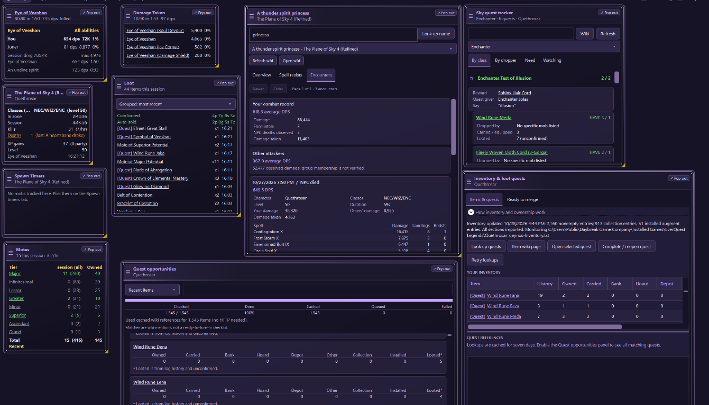

# EqLog Overlay

A Windows companion for EverQuest Legends: combat meters, spell and spawn timers,
inventory tools, quest references, and custom alerts. Use floating panels over the
game or a docked dashboard on another monitor.

## Installation

Download **EqLogOverlay-win-Setup.exe** from the
[latest release](https://github.com/AnQueth/eql/releases/latest), close any running
copy, and install. Windows x64 is required; the .NET runtime is included.
The installer is unsigned, so Windows may show a warning.

For portable use, extract **EqLogOverlay-win-Portable.zip** in full and run
**EverQuest Log Overlay.exe**. Keep the launcher, `Update.exe`, and `current`
directory together.

## First-time setup

1. In EverQuest, enter `/log on` and use windowed or borderless mode.
2. Select your Logs folder if automatic discovery does not find it.
   Change it later under **General > Log file**.
3. Under **General > Overlays**, enable the panels you want.
4. Use **Pop out** to float a panel; **Dock** returns it to a workspace.
5. Press **Ctrl+Shift+L** to unlock floating panels for moving, resizing, and
   interaction. Lock them again to pass clicks through to the game.
6. Enter `/outputfile inventory` to populate inventory tools. Repeat after
   looting, moving, spending, merging, or turning in items.

The app reads the selected log's history, then follows new entries.
**Follow newest log** switches files when another character's log is written.

## Layout and appearance

- Floating panels show only while EverQuest is active by default. Switching apps
  hides them without docking them. Disable **Only show floating overlays while
  EverQuest is active** to arrange them without the game.
- Drag a panel's header grip to move it and its resize grip to change its size.
  **Auto-arrange** controls whether neighboring docked panels move.
- Use **+** to add workspaces; right-click a tab to rename or delete it.
  **Move to** sends a docked panel to another workspace.
- **Appearance** controls themes and custom palettes. Per-panel font, opacity,
  and lock settings are under **General > Overlays**.

## Choose your panels

| Purpose | Panels |
|---|---|
| Combat | DPS and ability graphs, Damage Taken, Healing, Spell Casting |
| Timers | Spell Timers, Spawn Timers |
| Session | Session statistics, Loot, Forage, Chat |
| NPCs | Mob info from live `/consider`, searchable NPC compendium and encounters |
| Inventory | Inventory & loot quests, Ready to merge, Item upgrades, Exaltations |
| Planning | Motes, Mote upgrade planner, Leveling Analyzer |
| Reference | Quest opportunities, Sky quest tracker, Tradeskills, Wiki activity |
| Notifications | Alerts from custom text or regex triggers |

**Inventory:** counts and locations come from the last inventory export, not loot
messages. The export belongs beside the Logs folder. Click item names for EQLWiki
pages. Quest references are mentions, not verified turn-in requirements.
Exaltations in Equipment storage can be missing from the export; no search match
does not prove you do not own one.

**Timers:** configure tracked spells and mobs in **Spell durations** and
**Spawn timers**. Duration priority is **Override > Learned > Wiki**.
Countdowns are estimates; unlogged events cannot update them.

**NPCs:** `/consider` opens Mob info; use NPC compendium for saved history.
Observed resistance rates are not exact resistance stats or proof of immunity.
Reduced-damage estimates are separate from explicit resists.
Use `/who` after changing class loadouts to record your build and level.

**Planning:** export inventory before using Mote plans or HAVE/NEED counts.
Sky quests and tradeskill recipes are wiki references, not guarantees of in-game
eligibility. Leveling history measures logged XP gains, not guaranteed net XP.

**Alerts:** add simple text or regex rules in **Alert triggers**. Use `{C}` for
your character and `$1` for captured text. **Test** previews an alert.
Fresh installs include Feign Death failed/broken alerts and **DDD**, a 15-second
recast reminder after your Denon's Desperate Dirge hits a mob (including critical
hits). DDD ignores repeated hits during its countdown. Existing saved alert lists
are not changed.
Set **Delay** to alert some seconds after the match, such as a recast timer; the
Alerts overlay counts down until then. **Restart on repeat** restarts the countdown
when the line appears again. **Cooldown** (2 seconds by default) ignores repeat
matches right after a trigger fires, so a burst of lines shows one alert.
Startup history never fires triggers. In **Log lines**, select a line and use
**Copy message** to paste its text (without the timestamp) into an existing trigger.
Edit variable details such as damage numbers or mob names as needed.

## Updates, privacy, and saved data

- **General > Application updates** checks and downloads updates. Restart requires
  confirmation; a failed save blocks it. **What's New** contains release highlights.
- Game files are read-only. Wiki lookups send relevant item, NPC, and spell names,
  not log files or inventory exports. Cached results remain usable offline.
- Usage/error telemetry is **off by default**. The opt-in setting is under
  **General > Application updates**. Events contain fixed action labels,
  app/theme/panel state, an anonymous per-run session ID, and exception type/source;
  not game contents, personal names, paths, exception messages, or stack traces.
  The service may process standard network metadata.
- Data lives in `%AppData%\EqLogOverlay`. **Close the app and copy the entire
  folder to back up**, including journals and checkpoints. Close it before
  restoring, and do not share the folder with older app versions.
- **General > Tracking data > Reset tracking data...** backs up tracking and
  closes the app. Choose whether, after you reopen, existing log lines are
  ignored (start fresh from the reset) or reloaded (rebuild from the start of
  the log). Settings and original game files are preserved.
- **General > Wiki caches > Reset all wiki caches** refreshes reference data
  without clearing learned tracking.

## For developers

[Build, test, and architecture](docs/DEVELOPMENT.md) |
[Release checklist](docs/RELEASING.md)
