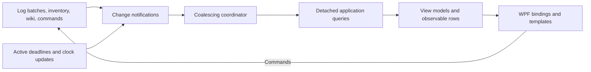

# Change-driven MVVM migration plan

## Goal and scope

Replace the overlay's timed, manual frame rendering with WPF bindings backed by
observable view models. Data changes should schedule only the work they require;
an idle application should not repeatedly capture and render an unchanged frame.
Preserve the current overlays, interactions, data, persistence, replay behavior,
themes, and window chrome.

This is an incremental migration across `EqLog.Overlay` **and**, where necessary,
the Application/Core notification and time-advancement boundaries. Each phase
must remain shippable. Do not remove the existing refresh path for a panel until
its replacement handles every source of changes.

## Current state

- `MainWindow` runs a 250 ms `DispatcherTimer`, captures a `LogSessionFrame`, and
  renders visible panels. `OverlayPanel.Update` compares rows and skips unchanged
  visuals, but snapshots and projections are still created on each tick.
- `LogSessionService.BatchProcessed` already signals processed log batches on
  the source worker. `LogSessionFrame` is currently **pulled**, not an event.
  Progress is stored separately without a progress-changed event.
- `GameSession.Revision` identifies a session replacement, not every data
  change. Inventory has its own revision; wiki, settings, and other inputs also
  change independently of log batches.
- `InventoryViewModel` already uses `INotifyPropertyChanged`, an observable
  collection, and a WPF collection view. Its inventory rows update several
  properties in place without individual change notifications.
- `AbilityDetailsView` uses observable collections for tables, while charts and
  `DpsFightList` still create and update controls imperatively. The DPS list has
  up to 20 fights, expandable inline compact/full details, and a saved
  **Full details** checkbox; there is no fight picker.
- `LogEngine.Snapshot(now)` is not a pure read: it advances resistance state,
  expires fights, and snapshots timers that finalize or prune pending state.
  Time-dependent maintenance must not disappear with the render timer.

See [MainWindow.xaml.cs](../src/EqLog.Overlay/MainWindow.xaml.cs),
[LogSessionService.cs](../src/EqLog.Application/Sessions/LogSessionService.cs),
[OverlayPanel.cs](../src/EqLog.Overlay/OverlayPanel.cs), and
[DpsFightPicker.cs](../src/EqLog.Overlay/DpsFightPicker.cs).

## Target architecture

Views bind to view-model properties, commands, and row collections. View models
use Application commands and detached query results, not live trackers, files,
HTTP, or WPF controls. Keep native window chrome, drag/resize, click-through,
and view-specific rendering such as graphs in the view layer. Bind theme keys or
semantic states to dynamic resources so theme changes continue to work.

### Change sources and scheduling

| Source | Required signal or action |
|---|---|
| Log batches | Reuse `BatchProcessed`; signal data invalidation after processing. Preserve every log event and live-only trigger/alert behavior. |
| Progress, reader completion/failure | Add progress and lifecycle notifications, including caught-up transitions with no new line. Report errors explicitly. |
| Session start, stop, switch, reset | Publish session generation and invalidate affected state; unsubscribe/cancel old work and reject late results. |
| Inventory and loot | Signal queued loot and inventory revisions; drain pending loot in bounded slices even when inventory UI is hidden. Signal export imports and reset/reconciliation results. |
| Wiki, NPC, leveling, tradeskill and other background work | Signal completion, failure, relevant revisions and cache resets; refresh only dependent views. |
| User actions and settings | Commands, filter/selection changes, tracked items, themes, and panel visibility invalidate the appropriate view, even without log input. |
| Time | Schedule countdown display changes, expirations and maintenance deadlines independently of incoming log events. |

Notifications describe **invalidation**, not a promise that data differs. Only
publish them after mutations are committed and outside state locks; subscriber
failures must not silently corrupt or stop ingestion. Preserve durable log
processing, trigger matching, alerts, and queued loot individually: coalescing
UI invalidations must never drop those events.

The coordinator must:

1. Track a session generation plus monotonically increasing dirty versions or
   equivalent per-domain state. `GameSession.Revision` alone is insufficient.
2. Coalesce bursts into bounded work, including during continuous replay; do
   not enqueue one dispatcher update or a complete snapshot per log line.
   Allow at most one query/apply operation per affected scope in flight.
3. Capture detached data off the dispatcher, then apply on the dispatcher.
   If a change arrives during capture or apply, retain the dirty marker and
   schedule another pass. Reject results from an old session, filter, or view.
4. Ensure related snapshot/query data is consistent enough for its consumers:
   use coordinated capture or revision validation and retry where needed.
5. Invalidate once when a hidden panel becomes visible, then stop unnecessary
   view-specific work when hidden. Unsubscribe and cancel on shutdown.

During active input, target the existing roughly 250 ms update responsiveness
without requiring an idle periodic frame. Preserve the existing one-operation
in-flight protection, replay responsiveness, and budgeted loot processing.
Do not introduce disk polling or constant writes: retain filesystem notifications
and background persistence independently of overlay visibility. Measure against
the current implementation rather than assuming binding alone is faster.

### Clock and replay

Replace the global frame timer with targeted timers or next-deadline scheduling:

- Keep spell and spawn countdowns, bars, warning transitions, and expiry current;
  retain the existing cadence where it affects visible smoothness.
- Expire fights, finalize/prune spell timers, advance resistance observations,
  remove alerts, and hide mob info at the correct times even without input or
  with a related overlay hidden. Separate advancement from reads where useful;
  tests must prove the old `Snapshot` side effects are retained.
- Preserve `LogSessionService`'s 30-minute live/replay transition and its use of
  last log time for replay snapshots. Schedule the transition itself, and do not
  advance replay countdowns using wall-clock time.
- Keep independent housekeeping, file monitoring, game visibility, save, and
  update-check mechanisms. They are not reasons to redraw every overlay.

## View-model and binding rules

- Use `INotifyPropertyChanged` for changing scalar and row properties, and
  `ObservableCollection<T>` for collections whose membership or order changes.
  An observable collection does **not** notify when a property of an existing
  item changes: notify the property or replace the item deliberately.
- Reconcile rows by stable identity, update only changed values, and preserve
  selection, expansion, scroll, sorting, column widths, and selected graph tab.
  The DPS `(target, start, occurrence)` key can shift for same-second duplicate
  fights; introduce a stable per-session fight identity before relying on it.
- Use data templates and commands for fight expansion, compact attacker rows,
  inline full details, quest actions, links, and tracking toggles. Keep the
  current saved **Full details** checkbox and clickable attacker breakdowns.
- Preserve virtualization and recycling for large lists. Avoid clearing and
  repopulating collections on every change; use a reset only for a measured
  large replacement and restore user state when necessary.
- Use the existing hand-written MVVM patterns first. Add CommunityToolkit.Mvvm
  only if its benefits justify a dependency change. `ICollectionView`, WPF
  dispatching, theme resources, and chart controls belong in WPF adapters/views,
  not portable domain logic.
- View-model tests can run off Windows only if the tested code is actually in a
  non-Windows target. Merely removing WPF references from a type inside the
  Windows-only overlay assembly does not make its tests portable.

## Incremental delivery

1. **Baseline and coordinator.** Record idle and active behavior; add change
   signals, generation/version handling, bounded coalescing, and targeted clock
   advancement behind the existing presentation path. Keep the old frame pump
   for panels not yet migrated. Verify no lost updates during replay, resets,
   session switches, or in-flight queries.
2. **DPS pilot.** Introduce stable fight identities and bound fight/attacker
   view models. Replace `DpsFightList`'s manual row controls with templates;
   preserve 20-fight ordering, simultaneous expansions, the saved checkbox,
   live inline charts, click behavior, and scroll state. Prove an unchanged
   snapshot causes no collection or property notifications.
3. **Time-sensitive and small overlays.** Migrate spell/spawn timers and alerts,
   then other simple panels. Exercise countdowns and expiry with a fake clock;
   retain smoothness and replay semantics without a global redraw.
4. **Inventory and browsers.** Correct item-property notifications and migrate
   inventory, loot quests, NPC, Sky, mob info, exaltations, and tradeskills.
   Preserve filtering, asynchronous cancellation, progress/error reporting,
   selection and list virtualization.
5. **Remaining UI and retirement.** Migrate leveling, mote planning, settings,
   and other panels; remove hidden-tab reparenting where replaced. Remove the
   global frame pump only after every panel and nonvisual responsibility has an
   event or clock-driven replacement. Keep independent housekeeping and native
   window behavior.

Existing panels can coexist with migrated panels during the transition. Do not
run both paths against the same panel after its cutover.

## Verification and acceptance

- **Idle:** over 60 seconds with no input, pending work, or active time-dependent
  state, count zero periodic full-frame captures, projections, and unchanged
  collection/property notifications. Independent housekeeping and visibility
  checks may still run.
- **Changes:** verify real log batches, progress-only transitions, session
  commands/resets, inventory exports, wiki completion/failure, filters, theme
  changes, and showing a hidden panel update the correct views without new log
  lines. Verify a change during an in-flight capture produces a later update.
- **Clock/replay:** use a controllable clock for spell/spawn countdowns, fight
  timeout, alerts, mob visibility, resistance advancement, and the 30-minute
  replay transition; verify no skipped side effects or wall-clock drift in replay.
- **Interaction:** verify duplicate fights and reorder/removal, compact/full
  inline details, attacker breakdowns, scrolling, selection, chart tabs,
  sorting, column widths, docking/floating, and theme changes.
- **Load and reliability:** exercise sustained historical import and rapid
  batches; compare latency, dispatcher work, allocations, and memory with the
  baseline. In a deterministic scheduler test, verify a dirty scope is scheduled
  within 250 ms even during continuous input, with at most one queued and one
  in-flight operation per scope. Verify bounded queues, no per-line dispatcher
  flood, no lost alerts/loot, explicit failures, and clean cancellation/disposal.
- Keep and extend `PresentationBoundaryTests` and `LayerBoundaryTests`; add
  focused coordinator and view-model tests plus WPF integration tests. Run
  existing affected suites at each phase. Record measurements and remaining
  limits; do not claim idle or responsiveness improvements without measuring.
