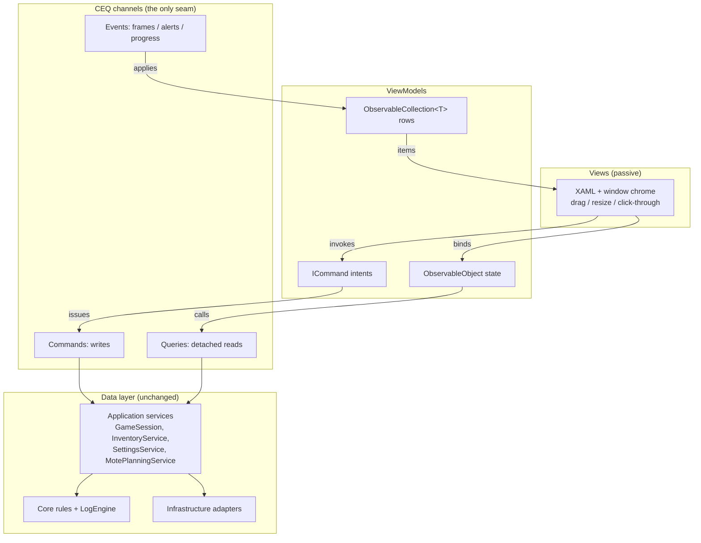

# MVVM + CEQ Migration Plan (EqLog.Overlay)

Plan to convert the Overlay presentation layer to MVVM, with **Commands / Events / Queries (CEQ)**
as the only channel between the UI and the data layer (Application → Core/Infrastructure).
Core, Application, and Infrastructure are unchanged in behavior; this is an `EqLog.Overlay`
refactor plus boundary-test updates.

## 1. Goals

- Views become passive: XAML + window chrome (drag/resize/click-through) only. No state, no rules.
- ViewModels own all UI state and expose **`ICommand`** for every user intent and
  **`ObservableCollection<T>`** for every row collection.
- CEQ is the enforced seam: VMs issue commands, subscribe to events, and call queries —
  never touching `LogEngine`, mutable stores, files, HTTP, or WPF-specific data types.
- Row updates stay incremental (no full rebuilds); existing performance budgets are preserved
  (250 ms render timer, one frame in flight, 8 ms replay work budget, 5 ms loot pump).
- Each phase is independently shippable; the WPF code-behind version remains the fallback
  per panel until its VM lands.

## 2. Current state

| Asset | Lines | Role today |
|---|---|---|
| `MainWindow.xaml.cs` | 2,278 | Settings UI, session controls, hidden controller window |
| `OverlayPanel.cs` | 1,303 | Programmatic row rendering for all floating panels |
| `DockWindow.cs` | 1,151 | Docked panel host + settings side panel |
| `MoteUpgradeOverlay.cs` | 1,022 | Mote planning UI (4 plan tabs) |
| `OverlayPresenters.cs` | 821 | Static presenters; **leaks WPF `Brush` into presenter layer** |
| `LootQuests.cs`, `MobInfo.cs`, `ThemeEditor.cs`, `NpcBrowser.cs`, `SkyQuestBrowser.cs` | ~2,400 | Browser-style overlays in code-behind |
| `ViewModels/InventoryViewModel.cs` | 266 | The one existing VM — hand-rolled `INotifyPropertyChanged`, `CollectionViewSource` filter |

The data layer already speaks CEQ implicitly: views call `GameSession` commands, receive
`LogSessionFrame` events, and read detached read models. This plan makes that seam explicit
in the presentation layer and adds the MVVM mechanics (`ICommand`, `ObservableCollection`).

## 3. Target architecture

### 3.1 Commands (UI → data, writes)

Every user intent is an `ICommand` on a VM (`RelayCommand` / `AsyncRelayCommand`).
The command body calls the matching Application method — nothing else. No engine access,
no file/HTTP, no WPF types in the path.

| UI intent | VM command | Application target |
|---|---|---|
| Track/untrack spell | `SetSpellTrackedCommand` | `GameSession.SetSpellTracked` |
| Override / relearn duration | `SetDurationOverrideCommand`, `RelearnDurationCommand` | `SetSpellDurationOverride`, `RelearnSpellDuration` |
| Add/remove duration | `AddDurationCommand`, `RemoveDurationCommand` | `AddSpellDuration`, `RemoveSpellDuration` |
| Track/untrack spawn, override, relearn | `SetSpawnTrackedCommand`, … | `SetSpawnTracked`, `SetSpawnOverride`, `RelearnSpawn` |
| Apply spawn wiki | `ApplySpawnWikiCommand` | `ApplySpawnWiki` |
| Reset resistances / session | `ResetResistancesCommand`, `ResetSessionCommand` | `ResetResistances`, `ResetSession` |
| Save tracking | `SaveTrackingCommand` | `SaveSpellDurationsAsync`, `SaveSpawnsAsync`, `SaveMobsAsync`, `SaveNpcsAsync` |
| Import inventory export | `ImportExportCommand` | `InventoryService` import/reconcile |
| Quest lookups / complete-reopen | `LookupQuestsCommand`, `CompleteQuestCommand` | `InventoryService` + wiki queries |
| Mote plan changes | `ApplyPlanCommand` | `MotePlanningService` |
| Settings/theme save, import/export | per-tab commands | `SettingsService`, `ThemeService` |

### 3.2 Events (data → UI)

VMs subscribe to a small set of event channels; each has exactly one apply method:

| Event | Source | VM apply point |
|---|---|---|
| `LogSessionFrame` (`Snapshot`, `Chat`, `Replay`, `Queries`) | render timer pump (existing 250 ms, one frame in flight) | `ApplyFrame(frame)` — the only method that mutates row collections from live data |
| Alert trigger matches | `TriggerMatcher` via session | `AlertsViewModel.OnAlert(...)` |
| Tail progress (`TailProgress`) | `LogSessionService` | progress bar binding |
| Wiki/quest activity (`QuestWikiActivity`) | shared HTTP scheduler | status text bindings |
| Housekeeping ticks (2 s / 6 s / 10 s) | `HousekeepingService` | save-state indicators |

### 3.3 Queries (detached reads)

Queries return immutable value data; VMs project it into row view models and collections.
No calculated domain getters run in presentation — the read models already carry prepared
values (rates, rates-of-damage, upgrade math).

| Query | Returns |
|---|---|
| `EngineQuerySnapshot.Capture(engine, channels, …)` | `SpellDurations`, `SpawnCandidates`, `Chat` |
| `NpcReadModel.From(NpcEntry)` | encounters, DPS averages, resist evidence |
| `InventoryReadModel.Opportunities / SkyProgress / Motes` | quest opportunities, Sky progress, mote inventory |
| `MotePlanReadModel` | upgrade/farm/what-if math |
| `SessionQueries.ExperiencePercentPerHour` | XP/AA rate with warmup policy |
| `CombatQueries.PersonalDps` | per-fight DPS values |
| `RawLogQueries.Message / TriggerPattern` | raw-log filter status (enum + diagnostic, not sentences) |

## 4. Building blocks

- **CommunityToolkit.Mvvm** — `ObservableObject`, `RelayCommand`, `AsyncRelayCommand`,
  `[ObservableProperty]` source generators. (Alternative: keep hand-rolling like today's
  `InventoryViewModel`; more boilerplate across ~12 VMs.)
- **`ObservableCollection<T>`** for every row collection, replacing the presenter-driven
  `OverlayRow` rebuilds. Items are small row view models (value data + display strings),
  not WPF objects.
- **VM-owned filtering** — keep the existing `CollectionViewSource.GetDefaultView` filter
  pattern from `InventoryViewModel`, but owned by the VM; or a plain filtered projection.
  Either way, no code-behind filter state.
- **Theme-aware converters** — replace `OverlayPresenters`' direct `Brush` construction with
  `IValueConverter`s that resolve theme resources at render time. This is what removes the
  WPF leak from the presenter layer.
- **Window chrome stays in code-behind** — `OverlayWindow` drag/resize/click-through,
  `GameWindowWatcher`, native interop are View concerns. Normal MVVM; not modeled in VMs.

## 5. ViewModel inventory

| Surface | New VM | Notes |
|---|---|---|
| Spell countdowns + spawn timers | `SpellTimersViewModel` | durations/spawn rows, track/override commands |
| Inventory overlay | `InventoryViewModel` (convert existing) | first conversion; proves the pattern |
| Loot quests | `LootQuestsViewModel` | opportunities rows, lookup commands; **ends the hidden-tab XAML adoption** |
| NPC browser | `NpcBrowserViewModel` | encounters, resist classifications, pager modes |
| Sky quests | `SkyQuestsViewModel` | progress rows, HAVE/NEED counts |
| Mote planning | `MotePlanViewModel` | 4 plan tabs (Upgrade/Farm/WhatIf/Math) as sub-VMs or tab state |
| Exaltations | `ExaltationsViewModel` | search + results rows |
| Mob info | `MobInfoViewModel` | confirmation/result swap, wiki fields |
| Alerts | `AlertsViewModel` | active alerts, trigger editor, effect options |
| DPS / ability breakdown | `DpsFightViewModel`, `AbilityDetailsViewModel` | fight picker, timeline/ability rows |
| Settings tabs | one VM per tab (General, Tracking, Themes, Inventory, …) | splits `MainWindow.xaml.cs` |

## 6. Phased migration

Each phase ships independently; boundary tests pass at every step.

1. **Phase 0 — Foundation.** Add CommunityToolkit.Mvvm to `EqLog.Overlay`. Convert
   `InventoryViewModel` to toolkit types (same behavior). Proves the pattern end-to-end:
   command → Application, frame event → collection update.
2. **Phase 1 — Row VMs + converters.** Tame `OverlayPresenters`: row view models per panel,
   theme-aware converters for brushes/colors. Unblocks every panel; presenters become pure
   projections with no WPF types.
3. **Phase 2 — Small overlays.** `SpellTimers`, `ExaltationsOverlay`, `InventoryOverlay`
   (wires the converted VM to its panel).
4. **Phase 3 — Browsers.** `NpcBrowser`, `SkyQuestBrowser`, `LootQuests`, `MobInfo`.
   Loot quests lands here: the hidden `LootQuestsTab` adoption disappears; the overlay gets
   its own view + `LootQuestsViewModel`.
5. **Phase 4 — Mote planning.** `MoteUpgradeOverlay` (1,022 lines) with plan-tab sub-state.
6. **Phase 5 — MainWindow split.** Settings tab VMs + session controls; the hidden
   controller window shrinks to composition + hotkey handle only.

## 7. Boundary test updates

- `PresentationBoundaryTests`: update the allowed-call list so VM → Application service
  calls are permitted; keep rejecting domain rule methods, calculated domain getters, and
  live engine/store fields in presentation.
- **New rule:** ViewModels must not reference `System.Windows*` types (except unavoidable
  dispatcher marshaling). This is what makes them unit-testable off-Windows.
- `LayerBoundaryTests`: unchanged — Core/Application/Infrastructure are untouched.

## 8. Testing payoff

Today `EqLog.Overlay.Tests` is Windows-only WPF testing. After conversion, filter logic,
selection state, and command behavior become plain xUnit tests using the existing
fake-port patterns from `EqLog.Application.Tests`. Target: every VM has a non-Windows test
covering its commands (fake services), one event apply (synthetic frame), and query
projection (read model → collection).

## 9. Risks and open questions

- **`OverlayPresenters` rewrite is the biggest single chunk** — 821 lines of brush/geometry
  logic moving into row VMs + converters. Mitigated by doing it in Phase 1 with per-panel
  fallback until each panel's VM lands.
- **Frame pump frequency** — keep the existing one-frame-in-flight policy; VM `ApplyFrame`
  must stay allocation-light (row reuse, not new collections per frame).
- **Open:** CommunityToolkit.Mvvm vs hand-rolled (recommend toolkit); explicit per-domain
  CEQ facades vs direct Application calls (recommend direct — boundary tests already enforce
  the seam, and facades would duplicate the service surface).

## 10. Definition of done

- Every overlay has a VM; code-behind holds only window chrome and composition wiring.
- No hidden-tab XAML adoption remains (`LootQuestsContent` reparenting removed).
- Boundary tests pass with the new ViewModel rule; `LayerBoundaryTests` unchanged.
- New non-Windows xUnit coverage for all VMs (commands, event apply, query projection).
- No behavior change: same panels, same data, same performance budgets
  (250 ms render, one frame in flight, 8 ms replay budget, 5 ms loot pump).
